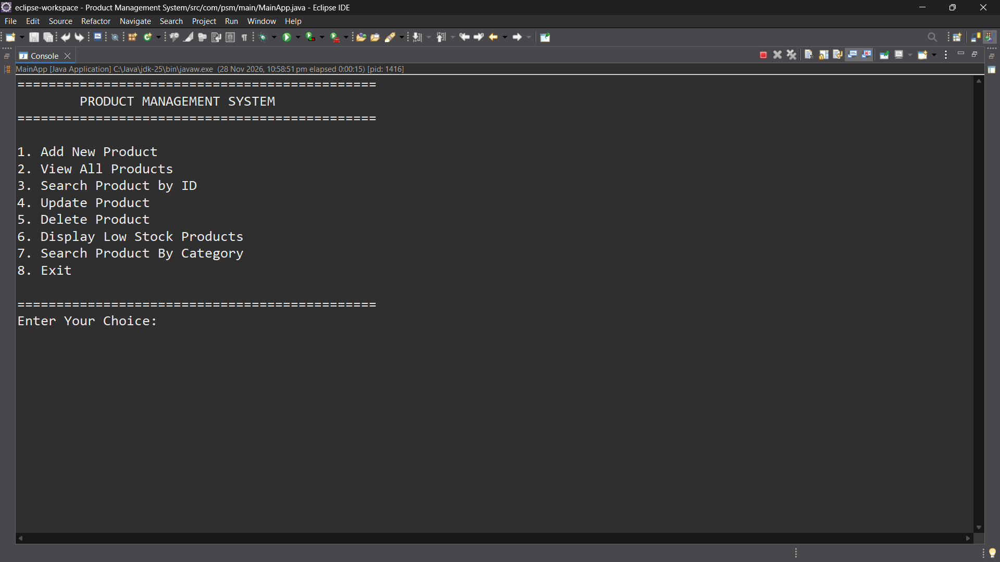
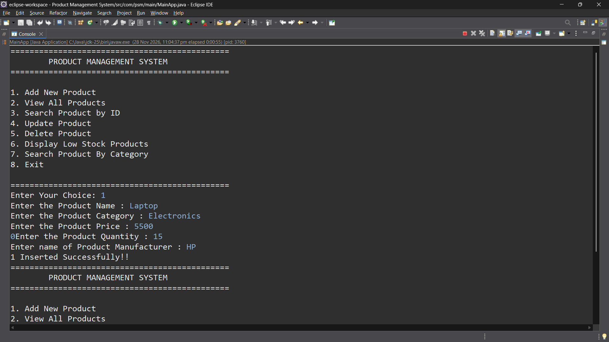
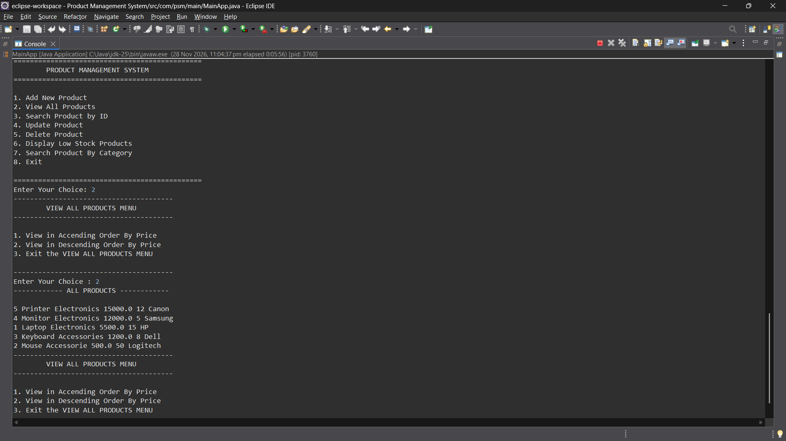
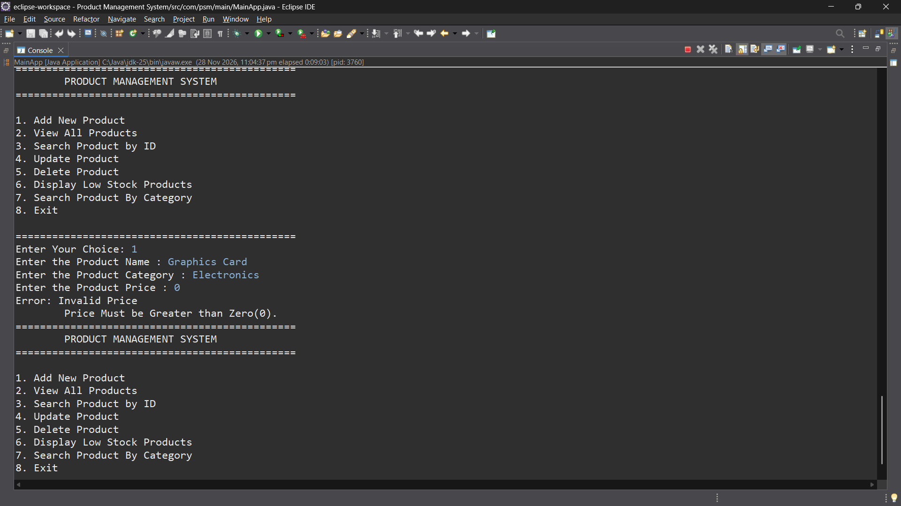
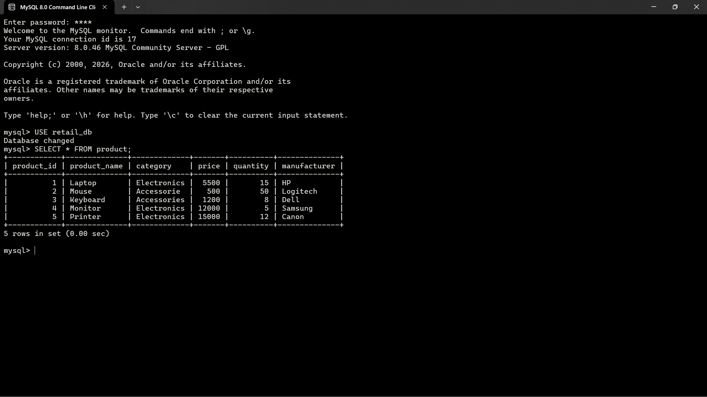

<div align="center">

# 🛒 Product Management System

### A console-based inventory manager built with **Core Java**, **JDBC** and **MySQL**




**Add • View • Search • Update • Delete • Low-stock alerts • Category search**

[Features](#features) · [Quick Start](#quick-start) · [Installation](#installation) · [Usage](#usage) · [Screenshots](#screenshots) · [Contributing](#contributing)

</div>

---

<a id="about"></a>
## 📖 About the Project

A retail company tracked its inventory in registers and Excel sheets, which made it hard to update prices, watch stock levels and find product details quickly. This application replaces that with a **menu-driven console program** that performs full CRUD operations on a **MySQL** database through **JDBC**.

It was built as a learning project to practise:

- JDBC with `PreparedStatement` (safe from SQL injection)
- The DAO pattern (`bean` / `dao` / `util` / `main` packages)
- Custom exceptions and input validation
- `try-with-resources` for automatic connection cleanup
- Sorting with `Comparator`

---

## 📑 Table of Contents

1. [Features](#features)
2. [Tech Stack](#tech-stack)
3. [Project Structure](#project-structure)
4. [Quick Start](#quick-start)
5. [Installation](#installation)
6. [Usage](#usage)
7. [Business Rules](#business-rules)
8. [Screenshots](#screenshots)
9. [Troubleshooting](#troubleshooting)
10. [Roadmap](#roadmap)
11. [Contributing](#contributing)
12. [Author](#author)

---

<a id="features"></a>
## ✨ Features

| # | Menu option | What it does |
|:-:|---|---|
| 1 | **Add New Product** | Inserts a product after validating price and quantity |
| 2 | **View All Products** | Lists every product, sorted by price ascending or descending |
| 3 | **Search Product by ID** | Finds one product, or reports that it doesn't exist |
| 4 | **Update Product** | Checks the product exists, then updates all its details |
| 5 | **Delete Product** | Deletes by ID and confirms whether it existed |
| 6 | **Display Low Stock Products** | Shows products below a quantity threshold you enter |
| 7 | **Search Product by Category** | Lists all products in a category |
| 8 | **Exit** | Closes the application |

**Also included:** friendly messages when nothing is found, recovery from invalid input (letters instead of numbers) without crashing, and graceful handling of database errors.

---

<a id="tech-stack"></a>
## 🧰 Tech Stack

| Area | Technology |
|---|---|
| Language | Java 8 or newer |
| Database | MySQL 8.x (5.7 also works) |
| Connectivity | JDBC with MySQL Connector/J 8.x |
| IDE | Eclipse (any Java IDE works) |
| Architecture | Console application, layered: Bean → DAO → Main |

---

<a id="project-structure"></a>
## 🗂️ Project Structure

```text
ProductManagementSystem/
├── src/
│   └── com/psm/
│       ├── bean/
│       │   └── Product.java              # Product model (fields, constructors, getters/setters)
│       ├── dao/
│       │   ├── ProductDao.java           # All database operations (JDBC)
│       │   └── DataAccessException.java  # Wraps SQL errors with a clear message
│       ├── util/
│       │   └── DBConnection.java         # Creates the database connection
│       └── main/
│           ├── MainApp.java              # Menu and user interaction
│           ├── InvalidPrice.java         # Thrown when price <= 0
│           ├── InvalidQuantity.java      # Thrown when quantity < 0
│           ├── SortProductsInAccOrd.java # Comparator: price low → high
│           └── SortProductsInDescOrd.java# Comparator: price high → low
├── lib/                                  # MySQL Connector/J jar (add your own)
├── sql/
│   └── schema.sql                        # Database + table + sample data
├── docs/
│   └── screenshots/                      # Images used in this README
└── README.md
```

---

<a id="quick-start"></a>
## ⚡ Quick Start

Already have Java, MySQL and Eclipse? Four steps:

```bash
# 1. Clone the repository
git clone https://github.com/<your-username>/Royal-Java.git

# 2. Create the database and sample data
mysql -u root -p < Royal-Java/ProductManagementSystem/sql/schema.sql

# 3. Open Eclipse → File → Import → Existing Projects into Workspace → select ProductManagementSystem
#    Add the MySQL Connector/J jar to the Build Path

# 4. Edit the password in DBConnection.java, then run MainApp.java
```

Need more detail? Follow the full guide below.

---

<a id="installation"></a>
## 🛠️ Installation

### Prerequisites

| Requirement | Check with | Download |
|---|---|---|
| JDK 8 or newer | `java -version` | [adoptium.net](https://adoptium.net) |
| MySQL Server 8.x | `mysql --version` | [dev.mysql.com/downloads](https://dev.mysql.com/downloads/mysql/) |
| MySQL Connector/J (JDBC driver) | n/a | [dev.mysql.com/downloads/connector/j](https://dev.mysql.com/downloads/connector/j/) |
| Eclipse IDE for Java Developers | n/a | [eclipse.org/downloads](https://www.eclipse.org/downloads/) |
| Git | `git --version` | [git-scm.com](https://git-scm.com) |

### Step 1: Clone the repository

```bash
git clone https://github.com/<your-username>/Royal-Java.git
cd Royal-Java/ProductManagementSystem
```

### Step 2: Create the database

Open MySQL Workbench or the MySQL command line and run `sql/schema.sql`, or paste this:

```sql
CREATE DATABASE retail_db;
USE retail_db;

CREATE TABLE product (
    product_id   INT PRIMARY KEY AUTO_INCREMENT,
    product_name VARCHAR(100),
    category     VARCHAR(50),
    price        DOUBLE,
    quantity     INT,
    manufacturer VARCHAR(100)
);

INSERT INTO product (product_name, category, price, quantity, manufacturer) VALUES
('Laptop',   'Electronics', 55000, 15, 'HP'),
('Mouse',    'Accessories',   500, 50, 'Logitech'),
('Keyboard', 'Accessories',  1200,  8, 'Dell'),
('Monitor',  'Electronics', 12000,  5, 'Samsung'),
('Printer',  'Electronics', 15000, 12, 'Canon');
```

### Step 3: Import the project into Eclipse

1. **File → Import → General → Existing Projects into Workspace**
2. Click **Browse** and select the `ProductManagementSystem` folder
3. Click **Finish**

### Step 4: Add the JDBC driver

1. Download the Connector/J **Platform Independent** ZIP and extract the `.jar`
2. Copy it into the project's `lib/` folder
3. Right-click the project → **Build Path → Configure Build Path → Libraries → Add JARs…**
4. Select the jar from `lib/` and click **Apply and Close**

### Step 5: Set your database credentials

Open `src/com/psm/util/DBConnection.java` and update these constants to match your MySQL setup:

```java
private static final String URLNAME  = "jdbc:mysql://localhost:3306/retail_db";
private static final String USERNAME = "root";
private static final String PASSWORD = "your-mysql-password";
```

> ⚠️ Never commit a real password to a public repository.

### Step 6: Run the application

Right-click `MainApp.java` → **Run As → Java Application**, then type your choices into the **Console** tab.

<details>
<summary><b>💻 Prefer the command line? Click to expand</b></summary>

<br>

**Linux / macOS**
```bash
javac -cp "lib/*" -d bin $(find src -name "*.java")
java  -cp "bin:lib/*" com.psm.main.MainApp
```

**Windows (PowerShell)**
```powershell
javac -cp "lib/*" -d bin (Get-ChildItem -Recurse src -Filter *.java).FullName
java  -cp "bin;lib/*" com.psm.main.MainApp
```

</details>

---

<a id="usage"></a>
## 🎮 Usage

When the program starts, you will see this menu:

```text
==============================================
	PRODUCT MANAGEMENT SYSTEM
==============================================

1. Add New Product
2. View All Products
3. Search Product by ID
4. Update Product
5. Delete Product
6. Display Low Stock Products
7. Search Product By Category
8. Exit

==============================================
Enter Your Choice:
```

Type a number and press **Enter**. Click each option below to see a real example.

<details>
<summary><b>1️⃣ Add a new product</b></summary>

<br>

```text
Enter Your Choice: 1
Enter the Product Name : Tablet
Enter the Product Category : Electronics
Enter the Product Price : 25000
Enter the Product Quantity : 10
Enter name of Product Manufacturer : Apple
1 Inserted Successfully!!
```

The ID is generated automatically by MySQL (`AUTO_INCREMENT`).

</details>

<details>
<summary><b>2️⃣ View all products (sorted by price)</b></summary>

<br>

Choosing option 2 opens a small sub-menu: view in **ascending** order, **descending** order, or go back. Ascending example:

```text
------------ ALL PRODUCTS ------------

2 Mouse Accessories 500.0 50 Logitech
3 Keyboard Accessories 1200.0 8 Dell
4 Monitor Electronics 12000.0 5 Samsung
5 Printer Electronics 15000.0 12 Canon
1 Laptop Electronics 55000.0 15 HP
```

Each line shows: `ID  Name  Category  Price  Quantity  Manufacturer`.

</details>

<details>
<summary><b>3️⃣ Search a product by ID</b></summary>

<br>

```text
Enter the ID You want to search : 1
1 Laptop Electronics 55000.0 15 HP
```

If the ID doesn't exist:

```text
Enter the ID You want to search : 99
Product With ID 99 NOT Found in the Database!!
```

</details>

<details>
<summary><b>4️⃣ Update a product</b></summary>

<br>

The program first checks that the ID exists, then asks for the new details:

```text
Enter the ID You want to Update : 2
Enter the New Product Name : Mouse Pro
Enter the New Product Category : Accessories
Enter the New Product Price : 750.5
Enter the New Product Quantity : 40
Enter name of New Product Manufacturer : Logitech
1 Rows Updated!!
```

If the ID doesn't exist, you get `Id Does not exist!!` and nothing is changed.

</details>

<details>
<summary><b>5️⃣ Delete a product</b></summary>

<br>

```text
Enter the ID You want to Delete : 3
Product 3 deleted successfully.
```

```text
Enter the ID You want to Delete : 99
Product 99 does not exist.
```

</details>

<details>
<summary><b>6️⃣ Display low-stock products</b></summary>

<br>

Enter a threshold, and every product with a quantity **below** it is listed. Using `10` matches the original requirement:

```text
Enter the Threshold You want : 10
3 Keyboard Accessories 1200.0 8 Dell
4 Monitor Electronics 12000.0 5 Samsung
```

If nothing is below the threshold you will see `The Database Don't have any low Stock Products`.

</details>

<details>
<summary><b>7️⃣ Search products by category</b></summary>

<br>

```text
Enter the Category You want to search : Electronics
1 Laptop Electronics 55000.0 15 HP
4 Monitor Electronics 12000.0 5 Samsung
5 Printer Electronics 15000.0 12 Canon
```

With MySQL's default collation the search is not case-sensitive, so `electronics` finds the same rows.

</details>

<details>
<summary><b>⚠️ Validation and error handling</b></summary>

<br>

**Invalid price:**
```text
Enter the Product Price : 0
Error: Invalid Price
	Price Must be Greater than Zero(0).
```

**Negative quantity:**
```text
Enter the Product Quantity : -5
Error: Invalid Quantity
	Quantity Cannot be Negative.
```

**Letters instead of a number:**
```text
Enter Your Choice: abc
Please enter a valid number.
```

The app never crashes on bad input. It shows a message and returns to the menu.

</details>

---

<a id="business-rules"></a>
## 📏 Business Rules

| Rule | How it is enforced |
|---|---|
| Price must be greater than zero | `InvalidPrice` exception in `MainApp` |
| Quantity cannot be negative | `InvalidQuantity` exception in `MainApp` |
| Product ID must be unique | `PRIMARY KEY AUTO_INCREMENT` in MySQL |
| Check existence before updating | `doesIdExist()` is called before the update prompts |
| Verify existence before deleting | `deleteProduct()` returns `false` if no row was removed |
| Show a message when nothing is found | Every list and search handles the empty result |
| Handle database errors | SQL errors are wrapped in `DataAccessException` |

---

<a id="screenshots"></a>
## 📸 Screenshots

<details open>
<summary><b>Click to collapse or expand the gallery</b></summary>

<br>

| Main menu | Add product |
|:-:|:-:|
|  |  |

| View all (sorted by price) | Update and delete |
|:-:|:-:|
|  |  |

| Validation and error handling | Database table |
|:-:|:-:|
|  | 

</details>

---

<a id="troubleshooting"></a>
## 🔧 Troubleshooting

<details>
<summary><b>❌ <code>Access denied for user 'root'@'localhost'</code></b></summary>

<br>

The username or password in `DBConnection.java` does not match your MySQL account. Update `USERNAME` and `PASSWORD`.

</details>

<details>
<summary><b>❌ <code>Communications link failure</code></b></summary>

<br>

MySQL is not running or is on a different port. Start the MySQL service and confirm it listens on `3306`, or change the port in `URLNAME`.

</details>

<details>
<summary><b>❌ <code>Unknown database 'retail_db'</code></b></summary>

<br>

You haven't created the database yet. Run `sql/schema.sql` (see [Installation → Step 2](#installation)).

</details>

<details>
<summary><b>❌ <code>ClassNotFoundException: com.mysql.cj.jdbc.Driver</code> or <code>No suitable driver</code></b></summary>

<br>

The Connector/J jar is not on the build path. Repeat **Installation → Step 4**.

</details>

<details>
<summary><b>❌ <code>Table 'retail_db.product' doesn't exist</code></b></summary>

<br>

The database exists but the table was not created. Re-run the `CREATE TABLE` statement from Step 2.

</details>

---

<a id="roadmap"></a>
## 🗺️ Roadmap

- [x] Full CRUD with `PreparedStatement`
- [x] Input validation with custom exceptions
- [x] Sort products by price (ascending / descending)
- [x] Low-stock and category search
- [ ] Find the most expensive product
- [ ] Calculate total inventory value
- [ ] Search products within a price range
- [ ] Increase prices by a given percentage
- [ ] Move credentials to a `db.properties` file
- [ ] Add a service layer for business rules
- [ ] Unit tests with JUnit
- [ ] Convert to a Maven project

---

<a id="contributing"></a>
## 🤝 Contributing

Contributions, bug reports and suggestions are welcome. This is a learning project, so friendly code reviews are especially appreciated.

### How to contribute

1. **Fork** this repository
2. **Create a branch** for your change
   ```bash
   git checkout -b feature/most-expensive-product
   ```
3. **Make your changes** and run every menu option to confirm nothing broke
4. **Commit** with a clear message
   ```bash
   git commit -m "feat: add most expensive product option"
   ```
5. **Push** your branch
   ```bash
   git push origin feature/most-expensive-product
   ```
6. **Open a Pull Request** describing what you changed and why

### Branch and commit naming

| Prefix | Use for | Example |
|---|---|---|
| `feature/` | New functionality | `feature/price-range-search` |
| `fix/` | Bug fixes | `fix/empty-category-message` |
| `docs/` | README or comment changes | `docs/update-screenshots` |
| `refactor/` | Code cleanup without behaviour change | `refactor/extract-print-method` |

Commit messages: `feat:`, `fix:`, `docs:` or `refactor:` followed by a short description in the present tense.

### Code guidelines

- Follow standard Java naming: `PascalCase` classes, `camelCase` methods and variables
- Keep database code in `ProductDao`; keep menu and input code in `MainApp`
- Always use `PreparedStatement` with `?` placeholders. Never build SQL by joining strings
- Use `try-with-resources` for every `Connection`, `PreparedStatement` and `ResultSet`
- Never leave an empty `catch` block
- Never commit passwords or the `bin/` folder

### Pull request checklist

Before opening a PR, confirm that you have:

- [ ] Run every menu option, including invalid inputs (letters, `0` price, negative quantity)
- [ ] Tested an ID or category that does not exist
- [ ] Not committed credentials or compiled `.class` files
- [ ] Updated the README if behaviour or menus changed

### Reporting a bug

Open an issue and include: what you did, what you expected, what happened, and your Java and MySQL versions.

---

<a id="author"></a>
## 👤 Author

**&lt;Your Name&gt;**

- GitHub: [@Aastha-0777](https://github.com/Aastha-0777)
- LinkedIn: [Aastha Lakhatariya](www.linkedin.com/in/aastha-lakhatariya-3138a9391)

---

<div align="center">

**If this project helped you, please give it a ⭐**

Made with ☕ and Java

</div>
